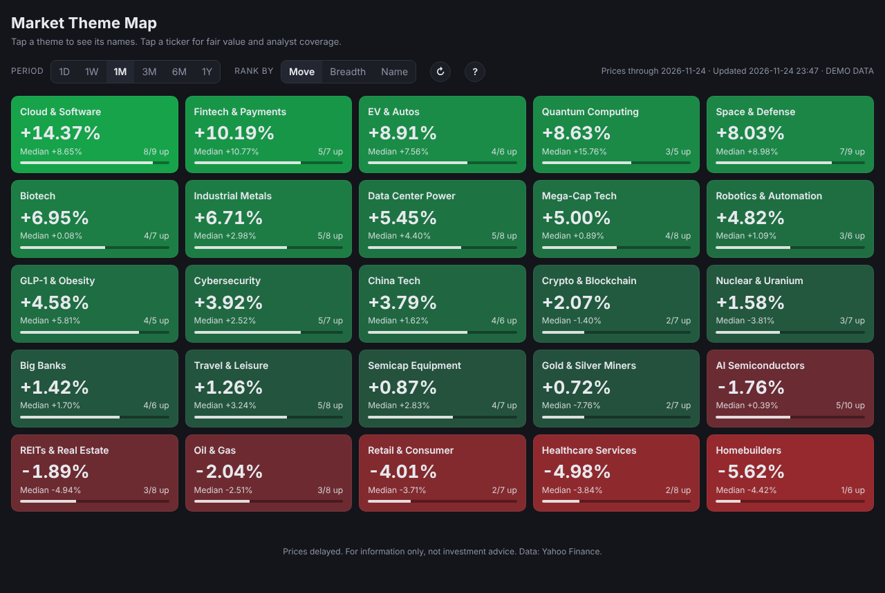

# Market Theme Map

A heatmap of the stock market grouped by investment theme, that runs on your own computer. Each tile is a theme (AI Semiconductors, Nuclear & Uranium, Homebuilders and so on) colored by how its stocks moved. Click a theme to see its stocks, then click a stock for its chart, the analysts' fair value and consensus rating.



## Features

- **25 themes, about 180 stocks**, all defined in one editable file, [`themes.json`](themes.json)
- **Six lookbacks:** 1D, 1W, 1M, 3M, 6M and 1Y, counted in trading sessions (1W is 5 sessions, 1Y is 252)
- **Rank themes** by average move, by breadth (share of stocks up), or by name
- **Theme stats:** equal-weighted average, median (so one big mover can't distort the picture) and breadth
- **Stock details:** price chart, analysts' mean price target and upside, low and high targets, number of analysts, consensus rating, P/E, market cap and 52-week range
- **Free, delayed data** from Yahoo Finance, refreshed every 5 minutes
- **No dependencies:** pure Python standard library plus one HTML page, so there's nothing to `pip install`

## Quick start

You need [Python 3.10 or newer](https://www.python.org/downloads/).

**Windows:** double-click `run.bat`. When installing Python, tick "Add python.exe to PATH".

**Any OS:**

```
python app.py
```

Your browser opens <http://localhost:8050> once prices have loaded, which takes 10 to 30 seconds. Leave the terminal window open while you use it, and close it (or press Ctrl+C) to stop.

| Option | What it does |
| --- | --- |
| `--demo` | Uses made-up prices, so it works offline |
| `--port 8051` | Runs on a different port |
| `--no-browser` | Doesn't open a browser tab |

## Customizing themes

Edit `themes.json`. Each entry is a theme name followed by its Yahoo Finance symbols:

```json
"My Theme": ["AAPL", "MSFT", "BRK-B"]
```

Use Yahoo's symbol format, for example `BRK-B`, `RY.TO` for Toronto, or `^GSPC` for an index. Save the file and press ↻ in the app to pick up the change. A stock can appear in more than one theme.

## How it works

- `app.py` is a small local web server. It downloads 14 months of daily prices for every symbol from Yahoo's chart endpoint, computes each theme's figures, and serves them to the page as JSON. Analyst data is fetched when you open a stock and cached for 6 hours.
- `static/index.html` is the whole front end: plain HTML, CSS and JavaScript with no build step.
- The server only listens on `127.0.0.1`, so other computers on your network can't reach it.

## Running the tests

The tests fake Yahoo's responses, so they run offline:

```
python -m unittest
```

## Notes

- **Windows 11 Smart App Control:** the app avoids add-on packages such as numpy and yfinance on purpose, because Smart App Control blocks their unsigned DLLs.
- **Rate limits:** if Yahoo stops answering, the app keeps showing the last good data and retries a minute later. Symbols that Yahoo skips in one refresh keep their previous prices.
- **Refreshes happen in the background,** so the page stays responsive while new prices download.
- **Data source:** this uses Yahoo Finance's public but unofficial endpoints, which can change without notice. It's meant for personal use, so check Yahoo's terms before using it for anything else.

## Disclaimer

For information and education only. This is not investment advice, and prices are delayed.

## License

[MIT](LICENSE)
